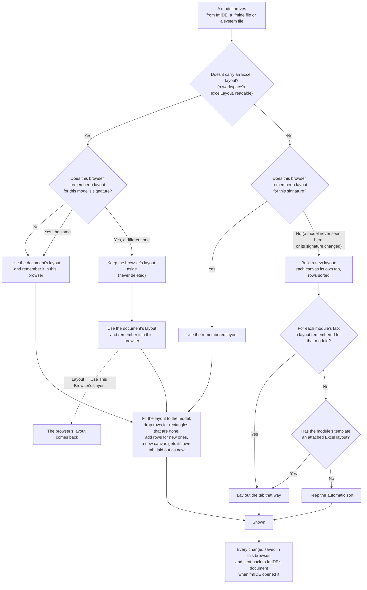
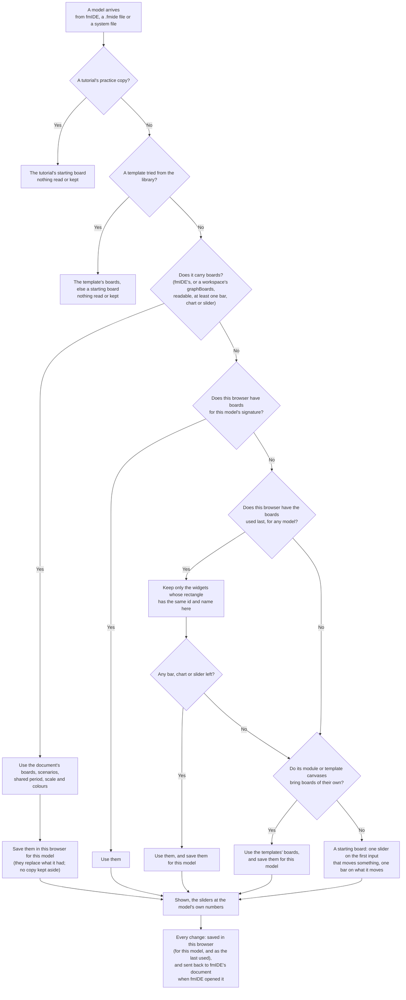

# Which layout wins

This page shows how ExcelExporter picks a model's Excel layout, and how fmGraph picks a model's boards. Each app makes the choice every time a model arrives: from fmIDE, from a `.fmide` file, or from a system file. It was worked out from the code on 3 November 2026 (ExcelExporter `loadModel` in `src/excel-exporter/js/04-file-formats.js`; fmGraph `loadBoardFor` in `src/fmgraph/js/04-board-edit.js`). When either changes, change this page with it.

Both apps remember things in the browser under a model's **signature**, a short code worked out from the ids of its canvases and rectangles. Adding or deleting a rectangle in fmIDE gives the model a new signature. The keys are listed in [storage.md](storage.md).

## ExcelExporter: the Excel layout

| What happens | Which layout you see |
|---|---|
| Open ExcelExporter from fmIDE, and fmIDE's document has a layout | The document's. It replaces this browser's if they differ; the browser's is kept aside. |
| Open ExcelExporter from fmIDE, and the document has no layout yet | This browser's, if it knows the model. Otherwise a new one. Your first change goes back into fmIDE's document. |
| Open a `.fmide` file saved with a layout (by fmIDE, or by Save for fmIDE) | The file's, as above. |
| Open a system file (`.json`), which never carries a layout | This browser's, if the signature matches. Otherwise a new one. |
| The model gained or lost a rectangle, and the file carries no layout | A new one: the signature changed, so the browser's layout isn't found. Coming from fmIDE avoids this, because fmIDE's document carries the layout. |
| A canvas was added since the layout was saved | The saved layout, plus a tab for the new canvas, laid out as a new layout would lay it out. |
| Layout → Reset Mapping to Defaults | A new one, with module layouts applied. The browser's copy is deleted. Nothing is saved until your next change, which also goes to fmIDE's document. Reopening a `.fmide` that carries the old layout brings it back. |
| Import Mapping JSON | The imported file's, fitted to the model, saved, and sent to fmIDE. |
| Layout → Use This Browser's Layout (shown only while one is kept aside) | The browser's layout from before the document's replaced it. |

## fmGraph: the boards

| What happens | Which boards you see |
|---|---|
| Open fmGraph from fmIDE, and fmIDE's document has boards | The document's. They overwrite this browser's boards for the model. |
| Open fmGraph from fmIDE, and the document has no boards yet | This browser's for the model, else the last used, else the templates', else a starting board. Your first change goes into fmIDE's document. |
| Open a `.fmide` file with boards | The file's. |
| Open a system file, which never carries boards | This browser's for the signature, else the last used, else the templates', else a starting board. |
| The model gained a rectangle, and the file carries no boards | Usually the same boards: the signature changed, but the boards used last are taken, keeping every widget whose rectangle is still there under the same name. |
| A rectangle was renamed | A widget keeps its rectangle's name. When it no longer matches (capitals and outer spaces aside), the widget is left out, wherever the boards came from. This stops another model that happens to use the same ids from picking the boards up. |
| Import Board, or Boards ▾ → Add boards from templates… | The imported or added boards. They are saved, and sent to fmIDE. |
| Slider positions | Never remembered: a board always opens on the model's own numbers. Scenarios keep named positions. |

## Where the two differ

- **Replacing what the browser had.** When a document brings a layout, ExcelExporter keeps the browser's earlier one aside and offers it back. When a document brings boards, fmGraph overwrites the browser's boards for that model and keeps no copy.
- **A model that changed.** With no document layout, ExcelExporter falls back to a new layout when the signature changes. fmGraph falls back to the boards used last, keeping what still fits.

Common to both:
- fmIDE's document is what carries the choice between apps. Each change goes back to it, and the next Save in fmIDE writes it into the `.fmide`.
- ExcelExporter's Layout → Use fmGraph boards… reads the document's boards only. It never reads fmGraph's browser storage.
- A showcase viewer carries its own copy of both. Nothing here changes a viewer already made.
