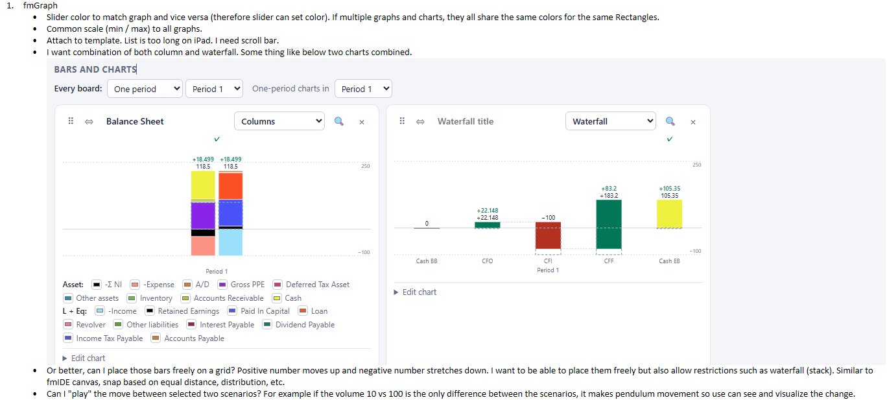

# fmGraph — the Free chart: columns and waterfalls together, placed on a grid

The owner's request (26 October 2026), two ideas in one:

1. *"I want combination of both column and waterfall."*
2. *"Or better, can I place those bars freely on a grid? Positive number moves up and negative number stretches down. I want to be able to place them freely but also allow restrictions such as waterfall (stack). Similar to fmIDE canvas, snap based on equal distance, distribution, etc."*



*The owner's screenshot (26 October 2026, CC BY 4.0 with the rest of `docs/`): today a balance sheet and a cash flow are two charts. The owner wants them as one.*

This is the brief, approved by the owner on 26 October 2026 (staged: F1, F2, F3). It is not in the build order yet: the owner chooses when it is built. F1 is built (27 October 2026, branch `claude/fmgraph-free-chart-f1`; see "How F1 turned out" at the end), and F2 (27 October 2026, branch `claude/fmgraph-free-chart-f2`; "How F2 turned out"); F3 is not.

## The owner's choices (26 October 2026)

1. **One layout, built in two stages.** A new chart layout, **Free**, made of *pieces*. Each piece is a stack of rectangles or a single step, and each says where it sits. Stage 1 lays the pieces out from a list (this answers idea 1). Stage 2 lets a person drag the pieces on a grid with fmIDE's snapping (idea 2). Both stages use the same file form, so nothing from stage 1 is thrown away.
2. **One period**, as in the screenshot. The chart follows the shared period like the other one-period charts do.
3. **Where a piece sits vertically** is one of four places: **on zero**, **on top of** another piece, **where another piece ends** (a waterfall step), or **at a number** typed in. A piece does not float at a height dragged by hand: a height a person drags means nothing in the model, and it could not be drawn the same way in Excel.
4. **Whole grid columns.** Across the chart, a piece stands in a whole column (0, 1, 2…), never between two. This keeps the chart something Excel can draw (see "ExcelExporter's Dashboard").
5. **ExcelExporter's Dashboard: a phase of its own, last (F3)**, starting with a check in Excel (see "ExcelExporter's Dashboard"). The order is F1, F2, F3.
6. **fmIDE's snapping moves to `src/shared/`.** fmIDE and fmGraph then use the same code, and nothing is copied. Both apps are under the Apache licence, so the move changes no licence.
7. **The screenshot is kept beside this brief** under CC BY 4.0, as above.
8. **The name is "Free".** `layout: "free"` in the file, and "Free" in + Chart and in the layout menu.
9. **Never in the template form**, like the other newer chart settings (`06c`, `06d` leave it out).

## Why

- **One picture tells the story.** A balance sheet beside the cash flow that moved it is easier to follow when the cash bar in the Asset stack and the Cash EB bar of the waterfall stand on the same scale, side by side, and move together when a slider moves.
- **Columns and Flow are two special cases of one idea.** A Columns group is a stack on zero, and a Flow step is a bar starting where the step before ended. Saying *where each piece sits* covers both, and also cases neither covers, such as a stack that starts where a waterfall ends.
- **Placing pieces should feel like fmIDE.** The owner arranges models on fmIDE's canvas every day: the blue guides, the equal-gap marks, Align and Distribute. A chart arranged the same way needs nothing new to learn.

## What a person does and sees

### Stage 1: the list (F1)

1. On a board, **+ Chart**, then choose **Free** from the layout menu at the chart's top. The chart starts empty, with "Add a piece to start" in words.
2. **Edit chart** lists the pieces. **+ Piece** adds one: a name ("Asset"), then its rectangles, one row each (the searchable rectangle list, `rectSelect`), **+ Rectangle**, ↑ ↓ ×. One rectangle makes a plain bar; several make a stack, with positive values going up and negative values hanging down, exactly as in a Columns chart today.
3. Each piece has **Sits:** with four choices:
   - **On zero**: the bar stands on the axis, as a Columns group or a Flow start does.
   - **On top of…** another piece: it starts at that piece's highest point (its lowest point, if that piece only goes down), as a second stack stacked on the first.
   - **Where … ends**: it starts at that piece's end (where the piece starts plus its net total), as a waterfall step.
   - **At a number** typed in, for a bar that should start at a set level, such as a target.
4. Each piece has **Minus**, which shows its value with the sign turned round, as a Flow's *subtract* step does ("CFI −100" hangs down from where CFO ended). The legend then shows the piece as "−Expense", as in the screenshot.
5. Each piece may have **Should equal…** another piece. The chart then puts ✓ when this piece's total agrees with that piece's end, or ✗ with both numbers in words, using the same rule as today's checks (`agree`, `AGREE_TOLERANCE`). Examples: Asset should equal L + Eq; Cash EB should equal where CFF ends; the cash bar in the balance sheet should equal Cash EB.
6. **Column**: the grid column the piece stands in, 0 for the first. In stage 1 a new piece takes the next free column, and ↑ ↓ move it along. Two pieces may share a column only when one sits on top of the other, or where the other ends.
7. **+ From chart…** copies another chart on the board into this one: a Columns chart's groups become pieces on zero, and a Flow's steps become pieces (start and total on zero, add where the step before ends, subtract the same with Minus, total with Should equal). The owner's two charts become one in a few clicks. The old charts stay where they are until the person removes them.
8. The **layout menu** also turns an existing Columns or Flow chart into a Free chart in the same way (`switchLayout`, which already keeps the rectangles between Columns and Lines).

What is drawn: each piece as a bar or a stack in its column, its name under it, its total above it (with the difference against A when A is pinned, as other charts do), the dashed connectors of a waterfall between a piece and the one it starts from, the key of rectangles and their colours, and the checks' ✓ / ✗. Moving a slider moves every bar its input reaches, and pieces resting on a moved piece move with it.

### Stage 2: placing on the grid (F2)

1. **Drag a piece** by its handle (or select it and use the arrow keys). Across, it moves column by column. Up and down, it does not move freely; instead the chart **proposes where it sits**: brought near zero, it shows a blue guide on zero; near the top of another piece, a guide there labelled "on top of Asset"; near another piece's end, a guide labelled "where CFO ends". Letting go takes the proposal shown. These are fmIDE's alignment guides, used to choose a place in the model rather than a free height.
2. **Equal spacing, as on fmIDE's canvas**: dragging a piece across shows the equal-gap marks (⟷) when the empty columns either side of it match the ones between its neighbours, and it snaps there. This is fmIDE's `equalSpacingSnap`, the rule of step 12a.
3. **Select several pieces** (Shift+click, or a box dragged round them) to get **Align bottoms** (all on zero), **Distribute** (spread evenly across the columns they span, the rule of fmIDE's `distributeSelected`) and **Tidy** (close up empty columns).
4. **Undo** puts back each move, as every board change does today (`04c-undo.js`).

The list in Edit chart stays and always shows the same thing as the grid: a person may use either, and a phone uses the list.

## How a number is worked out

- A piece's **value** is the sum of its rectangles in the chart's period (turned round when Minus is set). Its **positive part** goes up from where it sits, and its **negative part** goes down from there, as in a Columns stack. Its **end** is where it sits plus its value.
- **Where it sits** is worked out in order of what rests on what: pieces on zero or at a number first, then those resting on them. A loop (A on top of B, B where A ends) is refused in the editor; in a file, the pieces in a loop are put on zero and counted in the words under the chart.
- **A value that can't be worked out** (an error in the model) shows that piece as a gap with the reason in words. Pieces resting on it are not drawn, and the words say why ("rests on CFO, which has an error"). This never stops the chart.
- The calculation is fmGraph's own (`03-calc.js`): the chart reads the board's current results, with no runs of its own, so it costs nothing extra.

## How it fits with the work under way

- **One colour per rectangle across all the model's boards (board file 11, settled by the owner):** a piece's rectangles take their shared colour, so the cash bar in the Asset stack has the same colour as Cash EB in the waterfall and as the Cash slider. A Free chart keeps no colours of its own beyond what that work allows a chart.
- **A common min/max scale (board file 12, settled by the owner):** the Free chart takes the board's common scale like every chart, or its own fixed `scale` (board file 5).
- **"Play" between two scenarios (later):** while play moves the sliders, the pieces glide like any bar (`glide`, never with reduced motion), and where each piece sits is worked out again in every frame, so a step resting on a moving piece rides along with it.
- **The shared period (board file 9):** the chart's `period` follows the shared one unless the chart keeps its own (`ownPeriod`), as the Flow and Tornado charts do.

## The board file

Board file **version 13** (the next free number: 11 and 12 go to the two sessions above; if they land differently, this takes the next number when F1 is built). A chart of layout `free`:

```
{ "type": "chart", "wide": true, "layout": "free", "title": "Balance sheet and cash", "period": 0,
  "pieces": [
    { "id": "p1", "name": "Asset", "column": 0, "sits": { "on": "zero" },
      "parts": [ { "canvasId": "cBS", "nodeId": "cash", "name": "Cash", "colour": "#e8e83a" },
                 { "canvasId": "cBS", "nodeId": "ppe", "name": "Gross PPE" } ] },
    { "id": "p2", "name": "L + Eq", "column": 1, "sits": { "on": "zero" }, "check": "p1",
      "parts": [ { "canvasId": "cBS", "nodeId": "loan", "name": "Loan" } ] },
    { "id": "p3", "name": "Cash BB", "column": 3, "sits": { "on": "zero" }, "parts": [ … ] },
    { "id": "p4", "name": "CFO", "column": 4, "sits": { "on": "end", "of": "p3" }, "parts": [ … ] },
    { "id": "p5", "name": "CFI", "column": 5, "sits": { "on": "end", "of": "p4" }, "minus": true, "parts": [ … ] },
    { "id": "p6", "name": "Target", "column": 6, "sits": { "on": "level", "value": 100 }, "parts": [ … ] } ] }
```

- `sits.on` is `zero`, `top`, `end` or `level`; `of` names another piece's `id`; `value` is a number cut to ±1,000,000,000. Anything else reads as `zero`.
- `column` is a whole number from 0 to 39; `minus` is true or left out; `check` names another piece's `id` or is left out.
- Limits, as for the other charts (`CHART_LIMITS`): at most 40 pieces, 30 rectangles a piece, names 60 characters, the title 80.
- Read by `cleanChart`: rectangles that are not in the open model are left out and counted; an `of` or `check` naming no piece reads as zero / none; a loop goes on zero and is counted; ids are made again on reading, as widget ids are.
- **No upgrade step changes anything**: older files have no Free chart. The 12 → 13 step only raises the number, as 9 → 10 did. An older fmGraph asks before opening version 13 and shows the chart as empty.
- `docs/file-formats.md` describes it, with a version-12 sample in `tests/fixtures/formats/` and its test, in F1.

## What changes where

| Place | Change |
|---|---|
| **fmGraph's charts** (`04b-charts.js`) | The `free` layout: `cleanChart` rules, `freeFigures` (each piece's value, where it sits, its top, bottom and end, each rectangle's from / to, the checks), `switchLayout` from Columns and Flow. |
| **Drawing and editing** (`05b-chart-render.js`) | `drawFree`; the pieces' list in Edit chart; + From chart…; in F2 the drag on the grid, the guides and the equal-gap marks, Align bottoms, Distribute and Tidy. |
| **Template form** | None: left out, as the owner chose (`06c`, `06d`). |
| **`window.fmGraph`** | `addChart({ layout: 'free', title, period, pieces: [{ name, column, sits, minus, check, parts }] })`, with `of` and `check` given as a piece's place in the list (0, 1…) and the ids made inside; more than 40 pieces refused. `chart(id)` gives `{ period, pieces: [{ name, column, value, base, top, bottom, end, parts: [{ name, value, from, to }], check: { agree, a, b } }] }`. F2 adds `movePiece(chartId, index, { column, sits })`. |
| **Phone** (step 17) | The chart is drawn as on a computer, holding a piece opens the quick look (`openChartPeek`) with its rectangles and numbers, and Show and Share take it as they take any chart. Pieces are edited with the list only: dragging on the grid is for a computer or an iPad, where the board's handle already works with a finger. |
| **Trace and A/B** | 🔍 on the chart traces every rectangle in it, as for a Columns chart; A's dashed outlines and differences as on other charts. |
| **Shared code** (F2) | The geometry of fmIDE's snapping — `computeSnap` and `equalSpacingSnap` in `08-node-interaction.js`, the rule of `distributeSelected` in `06-align-marquee-computation.js` — moves to a new `src/shared/snap.js` as plain functions taking boxes and a distance (fmIDE passes `SNAP_THRESHOLD / zoom`). fmIDE calls it and behaves exactly as before (group 41 proves it); fmGraph calls it with columns as boxes. |
| **Help** | A topic for the Free chart, What's new (`src/help/fmgraph-whats-new.js`), and a step in a tutorial if the owner wants one (group 58). |
| **The manual** | A few lines in the fmGraph charts lesson, or a lesson of its own; Appendix A. |

## ExcelExporter's Dashboard (F3)

Step 19 B5 draws a board's bars and charts on the Dashboard as Excel charts. A Flow is drawn there already as a stacked-column waterfall over a hidden base series, with its helper rows written as formulas under it, so the chart follows the sliders (`09j-dashboard.js`, `dashFlowParts`). A Free chart in whole columns can be drawn by the same method, made general:

- Each grid column is one category of a stacked-column chart.
- Each rectangle in a piece is a segment from one number to another. The helper rows work out, as formulas, each segment's part above zero and below zero, and the **hidden filler** under it (the gap between zero, or the segment below, and this one).
- The series are written in the order the segments stack, so Excel's own stacking puts each where fmGraph does; the rectangles' colours are carried point by point, as the Flow's are.

**The risk:** Excel stacks values from zero in the order of the series, so a segment that changes sides of zero or swaps order with another when a slider moves needs the hidden fillers to follow in formulas. The Flow already does this for single steps; a stack resting on a moving waterfall end is harder. So F3 **starts with a check in Excel** (Windows and the iPad, as the owner checked B5): a workbook with the owner's balance sheet and cash flow, sliders moved through signs. If the method holds, F3 goes on. If it doesn't, a second method is tried: **floating bars drawn as thick error bars on a scatter chart**, which places any segment at any height with one series per rectangle, but needs the Excel writer (`js-head/`) to learn scatter charts with error bars. If neither is faithful, the Free chart is **left out of the Dashboard and listed in Use fmGraph boards…'s window as such**, as the scenario waterfall is today.

The layout file (`fmIDE-excel-mapping`) takes a new chart kind, `free`, with its pieces by row id; its version goes up by one with an old-version sample and its test, in F3.

## Phases, one pull request each

| Phase | Holds | Size |
|---|---|---|
| **F1** | **The Free chart from a list**: the layout, `freeFigures`, drawing, the pieces' editor, + From chart…, `switchLayout`, the checks, board file 13 with its sample and test, `docs/file-formats.md`, the API, the phone's quick look, help and What's new, the manual. | Medium |
| **F2** | **Placing on the grid**: `src/shared/snap.js` (fmIDE moved onto it first, unchanged), dragging pieces with the guides that propose where a piece sits, equal-gap marks, Align bottoms / Distribute / Tidy, undo, `movePiece`. | Medium to large (it touches fmIDE's canvas through shared code) |
| **F3** | **On the Dashboard in Excel**: the check in Excel first, then the helper rows and chart, the layout file's new version, or the chart listed as left out. | Medium (larger if the scatter method is needed) |

F1 is useful on its own: it answers the owner's first idea completely. F2 and F3 can come in either order after it.

## Tests

- **A new fmGraph group (the next free number, 82 today: `82-fmgraph-free-chart.spec.js`)**: the owner's case built through `fmGraph.addChart`, checked number by number against `fmGraph.chart(id)` (each piece's base, top, end); Minus; each kind of Sits; a loop refused in the editor and put on zero from a file; an error shown with the pieces resting on it; + From chart… from a Columns and a Flow chart giving the same bars; the checks' ✓ / ✗; a slider moving a piece and those resting on it; undo.
- **File formats**: the version-12 sample opens unchanged (group 49, or the formats group for fmGraph); a file with bad `sits`, unknown `of`, numbers as text and names with markup read safely (names shown as text, numbers forced to numbers).
- **F2**: group 41 (equal-spacing snap) and fmIDE's alignment tests run unchanged against the shared code; the shared functions also tested in Node (group 65, as the other modules); dragging in fmGraph tested through the page.
- **F3**: group 77 (graph boards in ExcelExporter), the Dashboard's chart and its helper formulas recalculated in LibreOffice against fmGraph's numbers.
- The phone's quick look of a Free chart in group 68.

## What stays the same

- fmGraph never changes the model. Nothing is sent anywhere. Every name is shown through `textContent`; every number from a file is forced to a number and every colour checked.
- No code is shared with ExcelExporter (decision 10): F3 is written in ExcelExporter's own code.
- Columns and Flow charts stay as they are; the Free chart sits beside them.

## Open points for the owner

1. **A tutorial step** for the Free chart (in "Charts" or a new tutorial), or help only?
2. **When to build it** (F1, F2, F3 in that order, as chosen).
3. **If F3's check in Excel fails both methods**: the chart is left out of the Dashboard and listed as such, unless the owner then chooses otherwise.

## Risks

- **Excel's stacking** (F3), as above: the reason F3 starts with a check.
- **Moving fmIDE's snapping into shared code** (F2) touches every drag on fmIDE's canvas. It is moved first with no change to behaviour, and proven by fmIDE's existing tests, before fmGraph uses it.
- **Many choices per piece** could make Edit chart long. Each piece's row shows its name and Sits on one line, with the rest under a fold, as the sliders' Range and step is.
- **Board file numbers** depend on the order the other sessions land; the number is fixed when F1 starts.

## How F1 turned out (27 October 2026)

Built as briefed, with the owner's answers of 27 October 2026 to the plan's choices:

1. **ExcelExporter reads board file 13** now, not in F3: otherwise Use fmGraph boards… would have refused every board saved after F1. A Free chart is listed under Not carried as "N Free charts not carried yet.".
2. **Help only**, no tutorial step (open point 1).
3. **Free back to Columns** makes a group of each piece (up to 12).
4. **Two pieces in one column with neither resting on the other** (from a file, or after a change in the editor): the later one in the list moves to the next free column, counted in the words under the chart. "Resting on" goes through any chain, so a stack of three in one column is allowed; two pieces both on top of a third are not.

Also: the code is in two new files, `src/fmgraph/js/04f-free.js` (reading, the numbers, + From chart…) and `05n-free-chart.js` (drawing and the editor); the key's items are worked out as a list before they are drawn (`freeKeyItems`, `drawKeyGroups`), and a piece that is just its one rectangle has no label of its own in the key. **+ Chart** still starts a Columns chart; choosing Free turns its one rectangle into the first piece (the API's `addChart({ layout: 'free' })` starts empty, with "Add a piece to start"). On top of… moves a piece into that piece's column when it may stand there. The column is shown counting from 1 in the editor ("Column 1"), from 0 in the file and the API. The phone's quick look is the chart's (its rectangles in its period), as for any chart. Test group 84; the version written out in five groups became the helpers' `BOARD_FILE_VERSION`.

## How F2 turned out (27 October 2026)

Built as briefed, with the owner's answers of 27 October 2026 to the plan's choices (all four recommendations):

1. **Letting go with no guide near**: the piece keeps its Sits. A height is only ever chosen from the model.
2. **Dropped on a column it can't share**: the piece there (and its stack) swaps to the column the dragged piece left.
3. **What moves across with a piece**: the pieces resting on it in its own column (a stack on a stack); waterfall steps resting on it in other columns stay where they are.
4. **The tutorial**: one step, `free`, added to fmGraph's Charts tutorial (now 5 minutes): choose Free, then drag Gross profit up onto the guide "where −Cost of sales ends".

Also, where the code as it was changed the brief:

- **No separate handle**: a mouse drags a piece by its bars; a finger or pen holds it still first (`waitForHold`), so a quick swipe still scrolls the page. Dragging is on the board only: never on a phone (Edit chart's list), in the full screen or in a GIF, which draw the same chart.
- **fmIDE had no test of Distribute**: one was added to group 41 and shown passing on the old code (its own commit) before the move into `src/shared/snap.js` (`snapPlace`, `equalSpacingSnap`, `distributePositions`); `computeSnap` keeps its clamp at 0 and `SNAP_THRESHOLD / zoom`.
- **Places at the same height** (a piece that only goes down has its "top" where it ends): the piece's own Sits wins, then on top of a piece in the column it is going to, then where a piece in another column ends — so a waterfall step is offered "where … ends".
- **Guides** take the piece within 10 screen pixels; **equal spacing** across within half a column. **Align bottoms** needs two pieces chosen, **Distribute** three columns; **Tidy** works on the whole chart. A chosen piece's ↑ ↓ go to the next place it could sit above or below.
- `fmGraph.movePiece(chartId, index, { column, sits })` as briefed, returning `chart(chartId)`. No file format change. Code in `src/fmgraph/js/05p-free-grid.js` (the drag, the selection, the keys and the buttons) and `04f-free.js` (`pieceStack`, `sitsChoices`, `placePiece`, `alignPieceBottoms`, `distributePieces`, `tidyPieces`). Test group 89; groups 41, 58 and 65 extended.
- Not checked on a real iPad: the hold-then-drag is tested with Chromium's emulated touch only.
- **Found while testing**: a tutorial's practice change made less than 0.3 s before Finish could be saved over the person's own boards for the same model while the model from before was being opened again; fixed (`stopTutorial` drops a waiting save), with a test in group 58 that fails without the fix.
