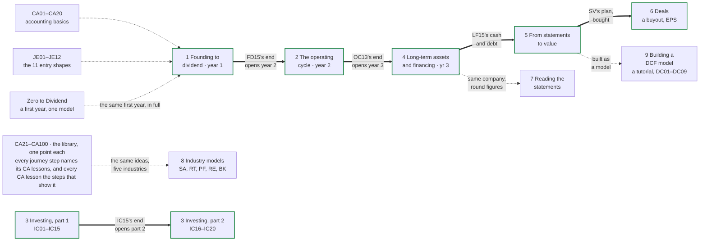

# The gallery's series: how they connect, and where to start

Written by `gallery/makers/guide.js` (the gallery repository) from the same guide the site's `/gallery` draws at its top (`gallery.json` version 2, `docs/file-formats.md`). Change it there and run `node gallery/makers/guide.js`; do not edit this file by hand.

## How the series connect

Solid green: the next series opens from the last state of the one before (its balances, or its plan). Dashed: related by the ideas or the company, without carrying its numbers.

## What each series is for

| Order | Series | Objective | Why it helps | Builds on |
|---|---|---|---|---|
| 1 | Counterintuitive accounting, Level 1 (CA01–CA20) and Journal entries (JE01–JE12) | The basic surprises (profit is not cash, an asset is not an expense) and the 11 shapes every entry takes | Tiny models, one point each: the words the journeys use | Nothing; either first |
| 2 | 1 From founding to dividend (FD01–FD15) | A trading company's first year, entry by entry, to the dividend | See the three statements and the BSPL move together, and why cash from operations differs from profit | Level 1 and JE. From Zero to Dividend is the same first year as one full model |
| 3 | 2 The operating cycle (OC01–OC13) | Year 2: growth on credit, working capital, provisions, bad debts, tax | Why a growing, profitable company runs short of cash; the whole bridge from profit to cash | Opens from FD15's year end |
| 4 | 4 Long-term assets and financing (LF01–LF15) | Year 3: a machine on a loan, depreciation, impairment, a sale, a lease, shares and share-based pay | The non-cash items, and the investing and financing lines that confuse a cash flow statement | Opens from OC13's year end |
| 5 | 7 Reading the statements (RS01–RS06) | Ratios: DuPont, liquidity and solvency, interest cover, quality of earnings, the cash conversion cycle | Turns the statements just built into judgments about return and risk | The same company in round figures; best after year 3 |
| 6 | 3 Investing in other companies (IC01–IC20) | A parent buying into a target in stages: the cost method, the equity method, control and consolidation, losing control | Why group accounts show what they show: goodwill, the non-controlling interest, eliminations | A separate company; part 2 opens from IC15. Needs only the journeys' basics |
| 7 | 5 From statements to value (SV01–SV11) | The company valued at the end of year 3: free cash flow, discounting, the terminal value, enterprise to equity value | Connects accounting to value, and shows what drives a DCF | Takes LF15's cash and debt; the journeys' cash from operations explains its free cash flow |
| 8 | 6 Deals (DL01–DL07) | A leveraged buyout of the same company, and EPS accretion against value | Why debt lifts returns both ways, and why EPS can rise while value falls | Uses SV's plan |
| 9 | Counterintuitive accounting, Levels 2–5 (CA21–CA100) | One point each on working capital, judgments, valuation, groups, leases and tax | Small, focused versions of what the journeys show, for revision or a single question | Use alongside 2–8: each names the journey steps that show it |
| 10 | 8 Industry models (SaaS, retail, project finance, real estate, banks) | What is counterintuitive in five industries, four showcases each | The same ideas where they bite hardest: deferred revenue, negative working capital, the cash waterfall, cap rates, bank capital | Best after the journeys and SV |
| 11 | 9 Building a DCF model (DC01–DC09) | A tutorial: the valuation of series 5 built in fmIDE, one canvas a step, with the years as periods, from revenue to the equity value | From reading a model to making one: drivers, prev(), cash from operations from net income, a check, a running total | SV (the same numbers and equity value, 1,654), and the journeys' cash from operations |
